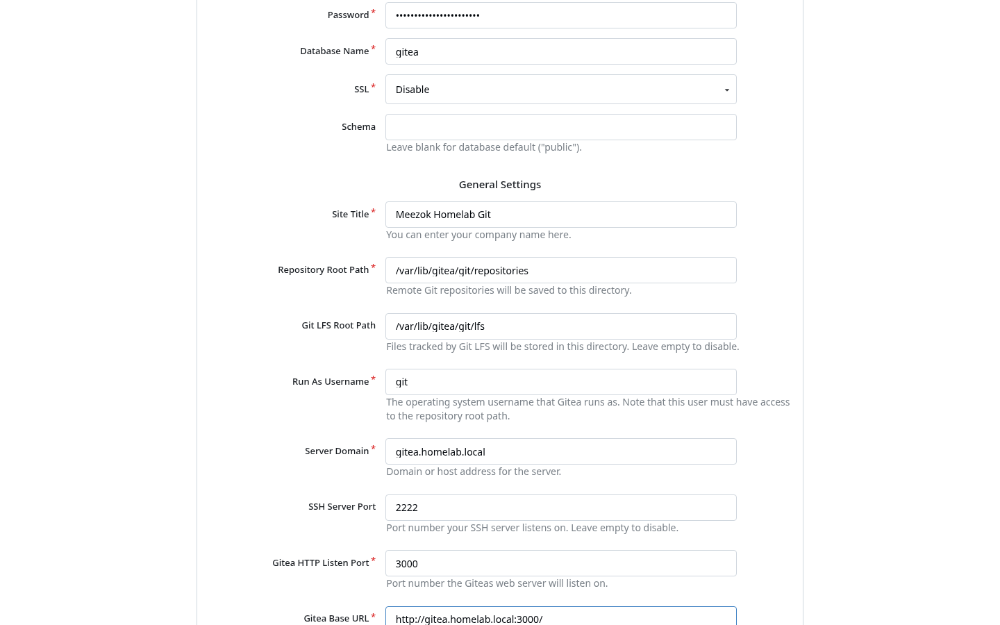
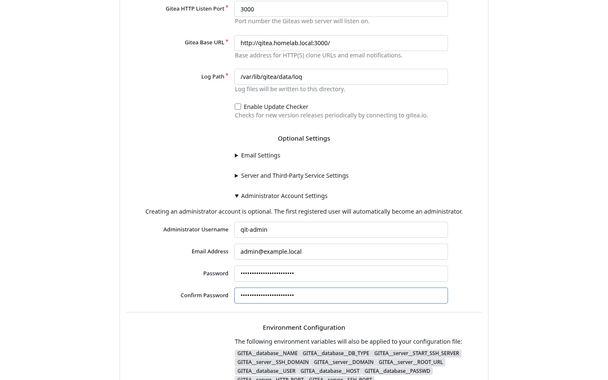
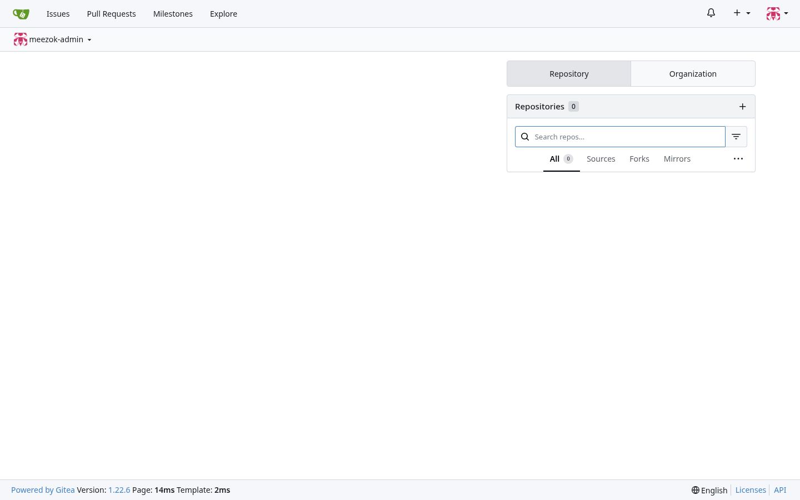
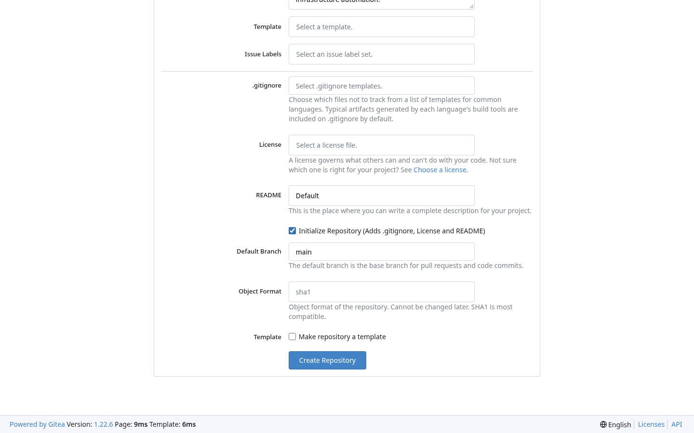
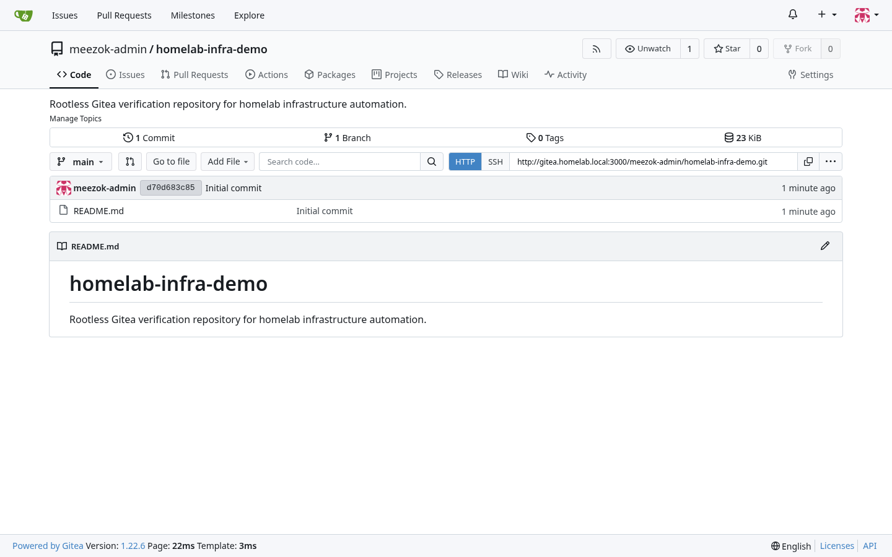
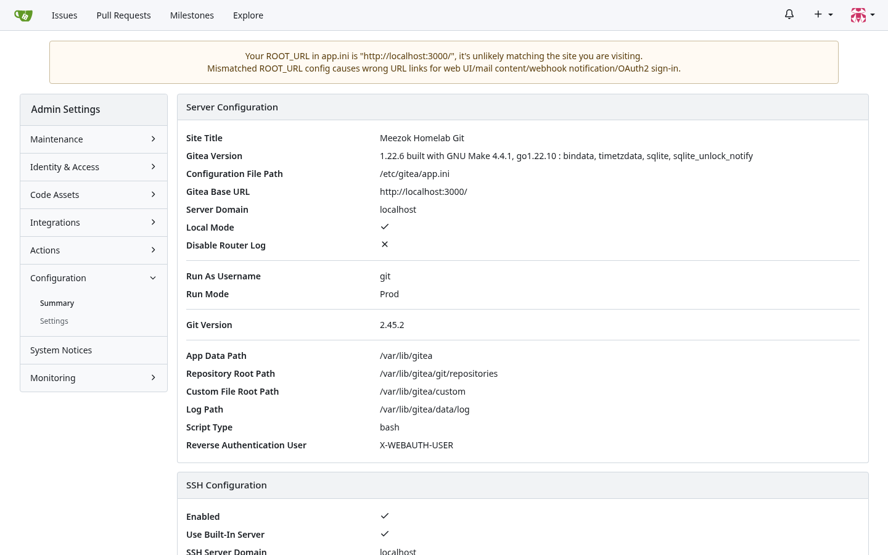

# Deploying Self-Hosted Gitea with Rootless Docker and PostgreSQL 16

> **Author**: Mohammed Al-Balushi  
> **Domain**: DevSecOps & Homelab Infrastructure  
> **Reference**: [Official Gitea Rootless Docker Documentation](https://docs.gitea.com/installation/install-with-docker-rootless/)

---

## 1. Why Rootless Gitea?

Traditional container deployments often run initial entrypoints or background daemons (such as OpenSSH and s6-overlay) as `root` (`UID 0`) inside the container before dropping privileges. In a multi-service homelab or enterprise environment, running a Git server—which parses untrusted Git hooks, webhooks, LFS objects, and SSH sessions—under `UID 0` increases the blast radius of a container escape vulnerability.

The official **Gitea Rootless Docker image** (`docker.gitea.com/gitea:1.22.6-rootless`) eliminates container root execution entirely:

1. **Non-Privileged Execution (`UID:GID 1000:1000`)**: The container starts and runs exclusively as the unprivileged `git` user (`1000:1000`).
2. **Built-in Go SSH Server (`2222/tcp`)**: Instead of relying on the host's OpenSSH daemon or binding privileged port `22`, Gitea uses its internal Go SSH server on unprivileged port `2222`.
3. **Strict Host Volume Ownership**: Repository data (`/var/lib/gitea`) and configuration (`/etc/gitea`) map cleanly to a standard non-root Linux account (`1000:1000`) on the host.

---

## 2. Prerequisites and Host Directory Preparation

Because the rootless container cannot `chown` host bind mounts at startup, you **must** create the `data` and `config` directories on the host and assign ownership to `1000:1000` before starting Docker Compose.

```bash
# 1. Create the stack directory structure
mkdir -p ~/gitea/{data,config,postgres}

# 2. Enforce 1000:1000 ownership and restrictive permissions
sudo chown -R 1000:1000 ~/gitea/data ~/gitea/config
chmod 750 ~/gitea/data ~/gitea/config
```

Create a restricted `.env` file (`chmod 600`) to hold the PostgreSQL database password outside `docker-compose.yml`:

```bash
cat > ~/gitea/.env << 'EOF'
GITEA_DB_PASSWORD=<STRONG_DB_PASSWORD>
EOF
chmod 600 ~/gitea/.env
```

---

## 3. Production `docker-compose.yml` (Rootless + PostgreSQL 16)

```yaml
services:
  server:
    image: docker.gitea.com/gitea:1.22.6-rootless
    container_name: gitea
    restart: unless-stopped
    user: "1000:1000"
    environment:
      - GITEA__database__DB_TYPE=postgres
      - GITEA__database__HOST=db:5432
      - GITEA__database__NAME=gitea
      - GITEA__database__USER=gitea
      - GITEA__database__PASSWD=${GITEA_DB_PASSWORD}
      - GITEA__server__DOMAIN=gitea.homelab.local
      - GITEA__server__SSH_DOMAIN=gitea.homelab.local
      - GITEA__server__ROOT_URL=http://gitea.homelab.local:3000/
      - GITEA__server__HTTP_PORT=3000
      - GITEA__server__SSH_PORT=2222
      - GITEA__server__START_SSH_SERVER=true
    volumes:
      - ./data:/var/lib/gitea
      - ./config:/etc/gitea
      - /etc/timezone:/etc/timezone:ro
      - /etc/localtime:/etc/localtime:ro
    ports:
      - "3000:3000"
      - "2222:2222"
    depends_on:
      db:
        condition: service_healthy
    networks:
      - gitea-net

  db:
    image: postgres:16-alpine
    container_name: gitea-db
    restart: unless-stopped
    environment:
      - POSTGRES_USER=gitea
      - POSTGRES_PASSWORD=${GITEA_DB_PASSWORD}
      - POSTGRES_DB=gitea
    volumes:
      - ./postgres:/var/lib/postgresql/data
    healthcheck:
      test: ["CMD-SHELL", "pg_isready -U gitea -d gitea"]
      interval: 10s
      timeout: 5s
      retries: 5
    networks:
      - gitea-net

networks:
  gitea-net:
    external: false
```

---

## 4. Initial Web Configuration and Administrator Setup

1. Navigate to `http://gitea.homelab.local:3000/` and verify the pre-populated **Database Settings** and **General Settings**:



2. Expand **Administrator Account Settings** under **Optional Settings** and create a dedicated administrator account (`git-admin`):



3. Click **Install Gitea** to complete database initialization and sign into the dashboard:



---

## 5. Verification Repository and Site Administration Audit

1. Create and initialize a verification repository (`homelab-infra-demo`):





2. Inspect **Site Administration -> Configuration -> Summary** (`/admin/config`) to confirm rootless execution (`Run As Username: git`) and built-in SSH server activation:



---

## 6. Connecting Cursor IDE and Local Git via SSH (Port 2222)

1. Generate a dedicated Ed25519 SSH key on your workstation and upload the `.pub` key to **Gitea -> Settings -> SSH / GPG Keys**:

```bash
ssh-keygen -t ed25519 -C "cursor-gitea-key" -f ~/.ssh/gitea_ed25519 -N ""
cat ~/.ssh/gitea_ed25519.pub
```

2. Add the host configuration in `~/.ssh/config` so Cursor IDE and Git automatically use port `2222` and your Gitea key:

```sshconfig
Host gitea.homelab.local
    HostName gitea.homelab.local
    User git
    Port 2222
    IdentityFile ~/.ssh/gitea_ed25519
    IdentitiesOnly yes
```

3. Verify the SSH connection and connect your repository inside Cursor's terminal (`Ctrl+\``) or via **Git: Clone** (`Ctrl+Shift+P`):

```bash
ssh -T -p 2222 git@gitea.homelab.local
git remote add origin ssh://git@gitea.homelab.local:2222/git-admin/ISTER.git
git push -u origin main
```

