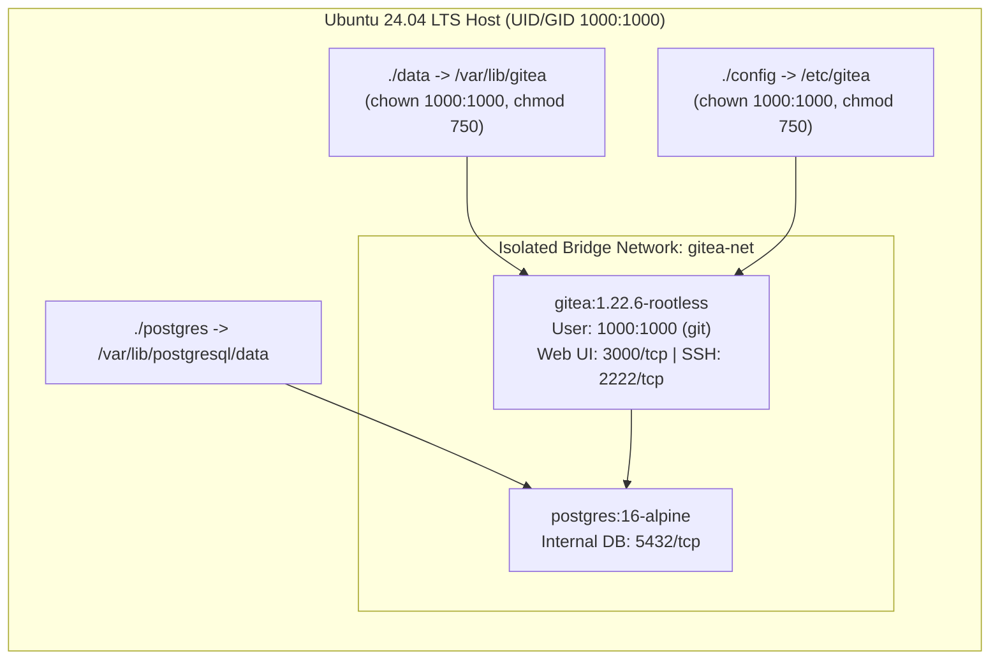
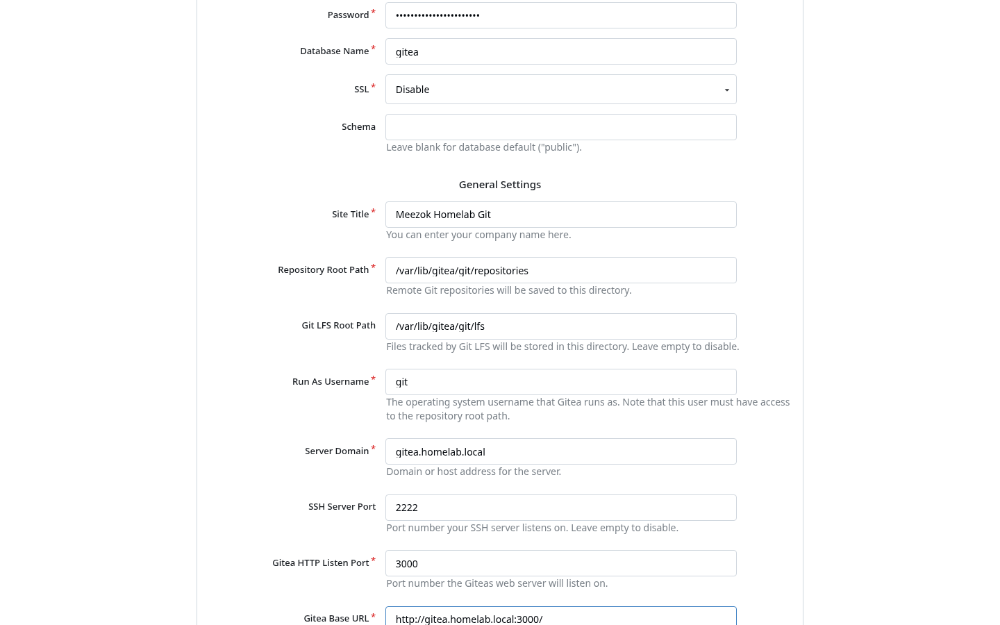
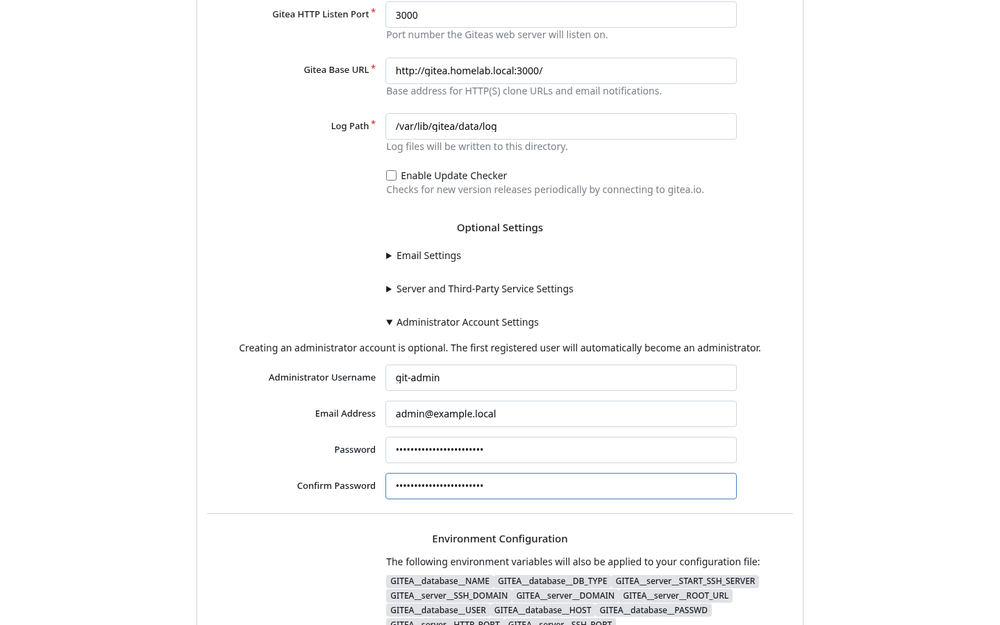
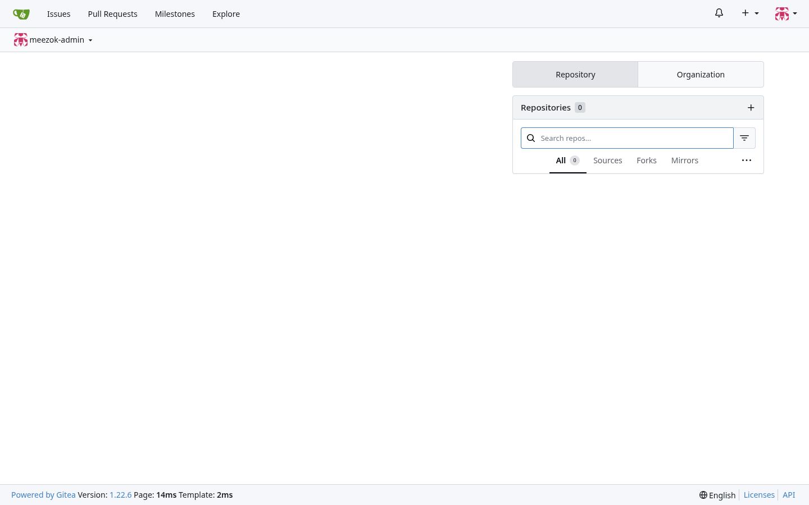
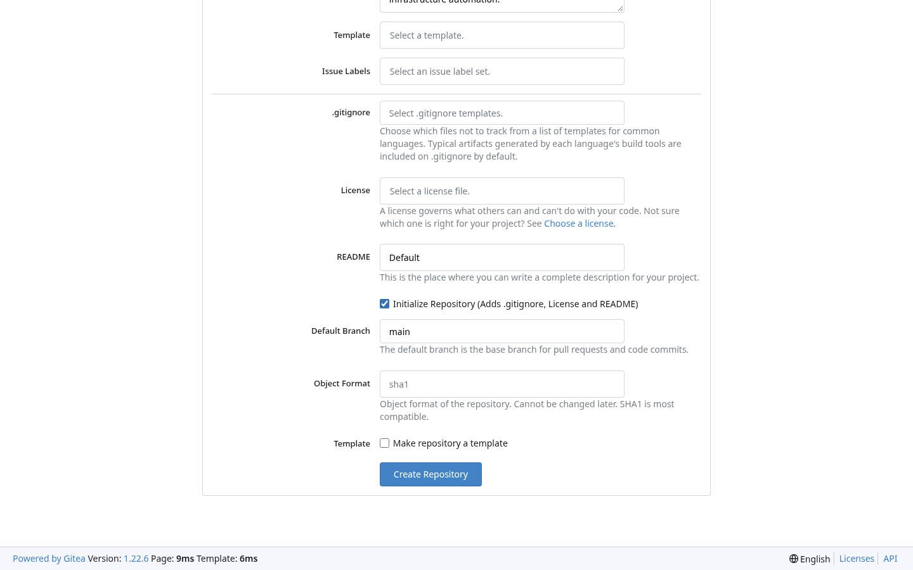
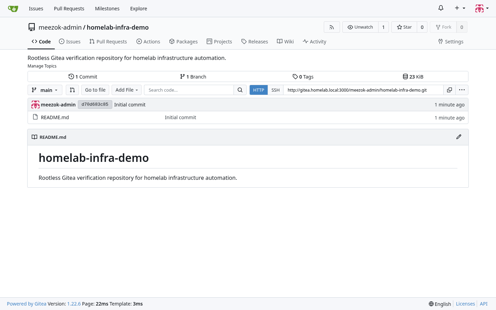
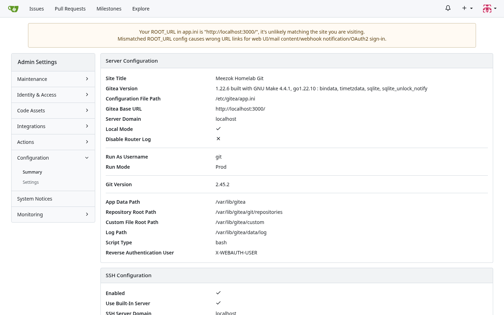

# Deploying Self-Hosted Gitea with Rootless Docker and PostgreSQL 16

> **Author**: Mohammed Al-Balushi  
> **Domain**: DevSecOps & Homelab Infrastructure  
> **Reference**: [Official Gitea Rootless Docker Documentation](https://docs.gitea.com/installation/install-with-docker-rootless/)

---

## 1. Why Rootless Gitea?

Traditional container deployments often run initial entrypoints or background daemons (such as OpenSSH and s6-overlay) as `root` (`UID 0`) inside the container before dropping privileges. In a multi-service homelab or enterprise environment, running a Git server—which parses untrusted Git hooks, webhooks, LFS objects, and SSH sessions—under `UID 0` increases the blast radius of a container escape vulnerability.

The official **Gitea Rootless Docker image** (`docker.gitea.com/gitea:1.22.6-rootless`) eliminates container root execution entirely:

1. **Non-Privileged Execution (`UID:GID 1000:1000`)**: The container starts and runs exclusively as the unprivileged `git` user (`1000:1000`).
2. **Built-in Go SSH Server (`2222/tcp`)**: Instead of relying on the host's OpenSSH daemon or binding privileged port `22`, Gitea uses its internal Go SSH server on unprivileged port `2222`.
3. **Strict Host Volume Ownership**: Repository data (`/var/lib/gitea`) and configuration (`/etc/gitea`) map cleanly to a standard non-root Linux account (`1000:1000`) on the host.



---

## 2. Prerequisites and Host Directory Preparation

Because the rootless container cannot `chown` host bind mounts at startup, you **must** create the `data` and `config` directories on the host and assign ownership to `1000:1000` before starting Docker Compose.

```bash
# 1. Create the stack directory structure
mkdir -p ~/gitea/{data,config,postgres}

# 2. Enforce 1000:1000 ownership and restrictive permissions
sudo chown -R 1000:1000 ~/gitea/data ~/gitea/config
chmod 750 ~/gitea/data ~/gitea/config
```

Create a restricted `.env` file (`chmod 600`) to hold the PostgreSQL database password outside `docker-compose.yml`:

```bash
cat > ~/gitea/.env << 'EOF'
GITEA_DB_PASSWORD=<STRONG_DB_PASSWORD>
EOF
chmod 600 ~/gitea/.env
```

---

## 3. Production `docker-compose.yml` (Rootless + PostgreSQL 16)

Create `~/gitea/docker-compose.yml`:

```yaml
services:
  server:
    image: docker.gitea.com/gitea:1.22.6-rootless
    container_name: gitea
    restart: unless-stopped
    user: "1000:1000"
    environment:
      - GITEA__database__DB_TYPE=postgres
      - GITEA__database__HOST=db:5432
      - GITEA__database__NAME=gitea
      - GITEA__database__USER=gitea
      - GITEA__database__PASSWD=${GITEA_DB_PASSWORD}
      - GITEA__server__DOMAIN=gitea.homelab.local
      - GITEA__server__SSH_DOMAIN=gitea.homelab.local
      - GITEA__server__ROOT_URL=http://gitea.homelab.local:3000/
      - GITEA__server__HTTP_PORT=3000
      - GITEA__server__SSH_PORT=2222
      - GITEA__server__START_SSH_SERVER=true
    volumes:
      - ./data:/var/lib/gitea
      - ./config:/etc/gitea
      - /etc/timezone:/etc/timezone:ro
      - /etc/localtime:/etc/localtime:ro
    ports:
      - "3000:3000"
      - "2222:2222"
    depends_on:
      db:
        condition: service_healthy
    networks:
      - gitea-net

  db:
    image: postgres:16-alpine
    container_name: gitea-db
    restart: unless-stopped
    environment:
      - POSTGRES_USER=gitea
      - POSTGRES_PASSWORD=${GITEA_DB_PASSWORD}
      - POSTGRES_DB=gitea
    volumes:
      - ./postgres:/var/lib/postgresql/data
    healthcheck:
      test: ["CMD-SHELL", "pg_isready -U gitea -d gitea"]
      interval: 10s
      timeout: 5s
      retries: 5
    networks:
      - gitea-net

networks:
  gitea-net:
    external: false
```

Launch the stack and verify that the process inside the container is running as `uid=1000(git)`:

```bash
cd ~/gitea
docker compose up -d

# Verify container status and rootless UID/GID
docker compose ps
docker exec gitea id
# Expected output: uid=1000(git) gid=1000(git) groups=1000(git)
```

---

## 4. Initial Web Configuration and Administrator Setup

### Step 1: Review Database and General Settings

Navigate to `http://gitea.homelab.local:3000/` in your browser. Because the database and server environment variables were passed in `docker-compose.yml`, the **Database Settings** and **General Settings** fields are pre-populated with rootless paths (`/var/lib/gitea/git/repositories`, run user `git`, and internal SSH port `2222`).



### Step 2: Configure the Default Administrator Account

Scroll down to **Optional Settings**, expand **Administrator Account Settings**, and configure your dedicated administrator account (`git-admin`) rather than relying on the first registered user becoming admin:



Click **Install Gitea**. Gitea initializes the PostgreSQL schema, writes `/etc/gitea/app.ini` with `0700` directory protection, and redirects to the signed-in dashboard:



---

## 5. Creating a Verification Repository and Auditing Configuration

### Step 1: Initialize a Test Repository

Click the **+** icon in the top navigation bar and select **New Repository**. Enter a repository name (`homelab-infra-demo`), check **Initialize Repository**, and click **Create Repository**:



Once initialized, the repository view provides both HTTP (`:3000`) and built-in SSH (`:2222`) clone endpoints:



### Step 2: Verify Rootless Runtime in Site Administration

Navigate to **Site Administration -> Configuration -> Summary** (`/admin/config`) to confirm that Gitea is running as username `git` in `Prod` mode with the built-in SSH server enabled and configuration stored at `/etc/gitea/app.ini`:



---

## 6. Post-Install Hardening and Health Checks

Verify the JSON health endpoint for automated uptime monitoring:

```bash
curl -s http://localhost:3000/api/healthz | jq .
```

```json
{
  "status": "pass",
  "description": "Meezok Homelab Git",
  "checks": {
    "cache:ping": [
      {
        "status": "pass"
      }
    ],
    "database:ping": [
      {
        "status": "pass"
      }
    ]
  }
}
```

### Recommended `app.ini` Security Controls

For private homelab or internal team deployments, disable self-registration and enforce sign-in viewing by adding the following under `[service]` in `~/gitea/config/app.ini` and restarting the container (`docker compose restart server`):

```ini
[service]
DISABLE_REGISTRATION = true
REQUIRE_SIGNIN_VIEW  = true
```

---

## 7. Connecting Cursor IDE and Local Git via SSH (Port 2222)

Because Gitea Rootless runs its built-in Go SSH server on port `2222` (while the host OpenSSH daemon remains on port `22`), SSH repository URLs use the `ssh://git@<gitea-host>:2222/<owner>/<repo>.git` syntax.

### Step 1: Generate an SSH Key and Register It in Gitea

On your development workstation, generate a dedicated Ed25519 SSH key for Gitea:

```bash
ssh-keygen -t ed25519 -C "cursor-gitea-key" -f ~/.ssh/gitea_ed25519 -N ""
cat ~/.ssh/gitea_ed25519.pub
```

In the Gitea web interface, navigate to **Profile Avatar -> Settings -> SSH / GPG Keys -> Add Key**, paste the public key contents, and save.

### Step 2: Configure `~/.ssh/config` for Port 2222

Add an entry to `~/.ssh/config` on your workstation so both terminal `git` and **Cursor IDE** automatically select your Gitea key and port `2222`:

```sshconfig
# Alias for Gitea Rootless SSH on port 2222
Host gitea.homelab.local
    HostName gitea.homelab.local
    User git
    Port 2222
    IdentityFile ~/.ssh/gitea_ed25519
    IdentitiesOnly yes
```

Test the SSH authentication handshake:

```bash
chmod 600 ~/.ssh/config
ssh -T -p 2222 git@gitea.homelab.local
# Output: Hi there, git-admin! You've successfully authenticated with the key named Cursor-Workstation, but Gitea does not provide shell access.
```

### Step 3: Push or Clone in Cursor IDE

#### Option A: Connect an Existing Local Project in Cursor Terminal (`Ctrl+\``)

```bash
git init
git branch -M main
git remote add origin ssh://git@gitea.homelab.local:2222/git-admin/ISTER.git
git add .
git commit -m "feat: initial commit"
git push -u origin main
```

#### Option B: Clone via Cursor Command Palette

1. Press `Ctrl+Shift+P` (or `Cmd+Shift+P` on macOS) and run **Git: Clone**.
2. Enter the full SSH URI with port `2222`:
   ```text
   ssh://git@gitea.homelab.local:2222/git-admin/ISTER.git
   ```
3. Choose your local workspace folder and click **Open**. Cursor's Source Control view (`Ctrl+Shift+G`) will push and pull directly over SSH port `2222`.

